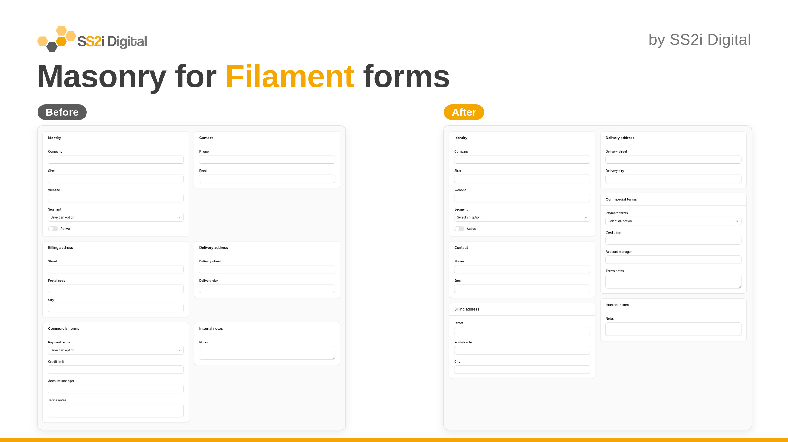
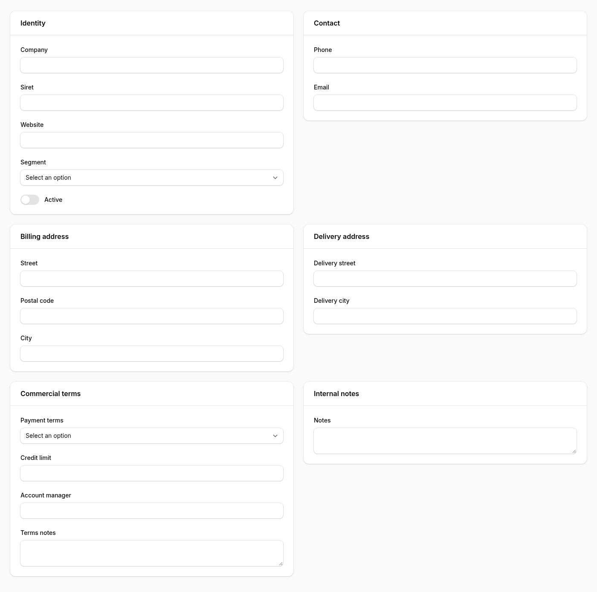
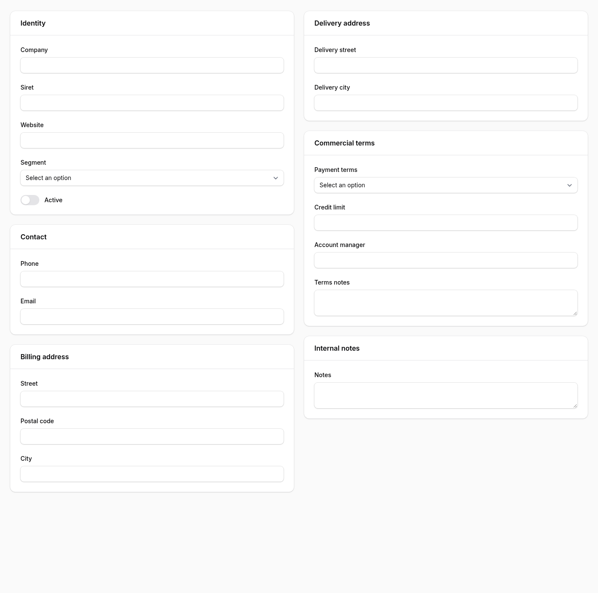
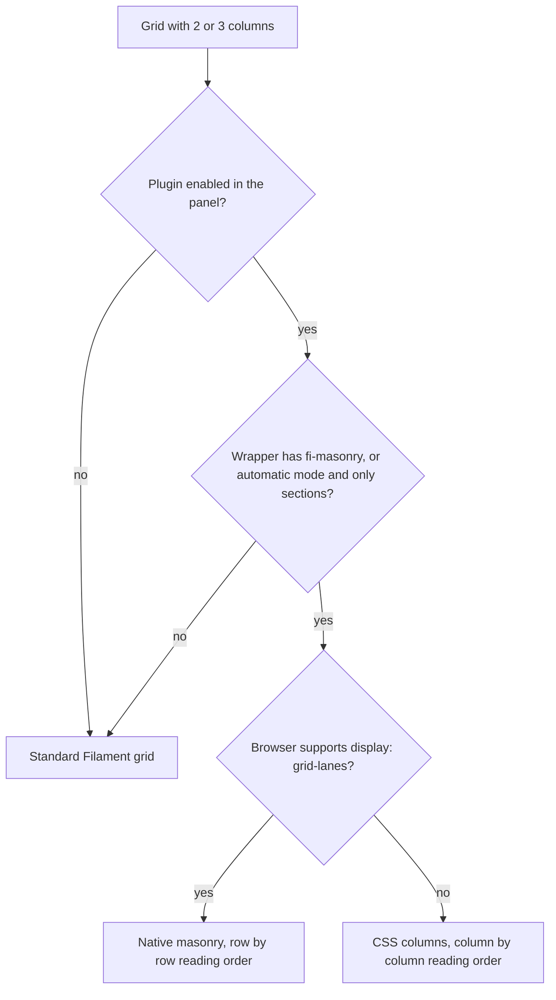

# Masonry for Filament forms

[](https://packagist.org/packages/ss2i-digital/filament-masonry)
[](https://github.com/ss2i-service-dev/filament-masonry/actions/workflows/tests.yml)
[](https://github.com/ss2i-service-dev/filament-masonry/actions/workflows/phpstan.yml)
[](https://packagist.org/packages/ss2i-digital/filament-masonry)



A Filament plugin that stacks the sections of a form or an infolist as a masonry: each section is placed under the previous one of its column, instead of leaving a large gap under the shorter section of every row. It is pure CSS, with no JavaScript and nothing to compile in your application.

| Before | After |
| --- | --- |
|  |  |

A Filament grid with two columns aligns its rows: a short section, such as a contact card, sits next to a long one and leaves empty space below it. This plugin makes the sections of the grid flow like cards, in two or three columns, and falls back to a single column on small screens as before.

## Installation

You can install the package with Composer:

```bash
composer require ss2i-digital/filament-masonry
```

Register the plugin in your panel provider. It is enabled panel by panel: the stylesheet is only linked in the panels that register the plugin.

```php
use Ss2iDigital\FilamentMasonry\FilamentMasonryPlugin;

public function panel(Panel $panel): Panel
{
    return $panel
        // ...
        ->plugin(FilamentMasonryPlugin::make());
}
```

The stylesheet is a Filament asset. Filament publishes it when you run `php artisan filament:upgrade` or `php artisan filament:assets`, which a default Filament installation already does after each `composer update`. You do not need Tailwind, a custom theme or a build step.

## Automatic mode

Once the plugin is registered, a grid becomes a masonry when all of these are true:

- it has two or three columns at the plugin breakpoint (`lg` by default), for example a schema with `->columns(2)`;
- every visible child of the grid is a section. A child that spans the whole row (`->columnSpanFull()`) may be anything: it breaks the columns, and the sections that follow start a new masonry below it;
- neither the grid nor its wrapper carries the `fi-masonry-disabled` class.

A grid that mixes fields and sections, or that has a single column, is left untouched. Nothing has to be declared in your schemas:

```php
public static function form(Schema $schema): Schema
{
    return $schema
        ->columns(2)
        ->components([
            Section::make('Identity')->schema([/* ... */]),
            Section::make('Contact')->schema([/* ... */]),
            Section::make('Billing address')->schema([/* ... */]),
            Section::make('Notes')->schema([/* ... */])->columnSpanFull(),
        ]);
}
```

## Settings

All the settings are fluent and optional:

```php
FilamentMasonryPlugin::make()
    ->auto(false)       // only the explicit component and the macro below, no automatic mode
    ->breakpoint('xl')  // md, lg (default) or xl
    ->gap('2rem');      // any CSS length, 1.5rem by default (the Filament gap)
```

- `auto(bool $condition = true)`: enable or disable the automatic mode described above.
- `breakpoint(string $breakpoint)`: the Filament breakpoint at which your grids declare their columns, `md`, `lg` or `xl`. The default `lg` matches `->columns(2)`, which Filament applies from `lg`. If your grids use `->columns(['default' => 1, 'md' => 2])`, set the breakpoint to `md`.
- `gap(string $gap)`: the space between the columns and between two stacked sections.

The settings are CSS custom properties and a marker in the page head, not generated rules, so the shipped stylesheet is the same for everybody. The gap is the `--fi-masonry-gap` variable, which you can also override in your own CSS, on a page or on a single grid.

## Explicit component

To get a masonry without relying on the automatic mode, even when the grid also contains fields, use the `Masonry` component. It works in forms and in infolists, and it spans the whole row:

```php
use Ss2iDigital\FilamentMasonry\Components\Masonry;

Masonry::make([
    Section::make('Identity')->schema([/* ... */]),
    Section::make('Contact')->schema([/* ... */]),
    Section::make('Billing address')->schema([/* ... */]),
])->columns(3),
```

`Masonry::make()` returns a regular Filament `Grid` with two columns, so you can use its other methods. The number of columns can be 2 or 3.

## Macro

The plugin adds a `masonry()` macro to `Filament\Schemas\Components\Grid`, to force the masonry on a grid or to exclude one:

```php
Grid::make(2)->masonry()->schema([/* ... */]);      // force the masonry, whatever the children are
Grid::make(2)->masonry(false)->schema([/* ... */]); // never a masonry, even in automatic mode
```

## Excluding a grid

`->masonry(false)` adds the `fi-masonry-disabled` class to the wrapper of the grid. You can add that class yourself with `->extraAttributes(['class' => 'fi-masonry-disabled'])`, or use the alias `no-masonry`.

## Compatibility

| Plugin | Filament | Laravel | PHP |
| --- | --- | --- | --- |
| 1.x | 4.x and 5.x | 11, 12 and 13 | 8.2 to 8.5 |

The markup of a Filament grid is the same in versions 4 and 5 (`fi-grid`, `fi-grid-col`, `fi-sc-component`, `fi-sc-section` and the `--cols-*` variables of the style attribute). The test suite renders a form and checks that these classes are still there, so that a change in a future Filament release shows up as a failing test instead of a silent loss of the layout.

The `:has()` selector is required: Chrome 105, Safari 15.4 and Firefox 121 or later. In older browsers the form keeps its normal grid layout.

## Reading order

Masonry layouts have two possible reading orders, and the plugin uses the best one available:

- Browsers that support native masonry (`display: grid-lanes`, in Safari at the time of writing, behind a flag in Chrome) use it through `@supports`. Sections are placed one after the other, row by row: the second section is at the top of the second column, the third goes under whichever column is shortest.
- All the other browsers use CSS columns. Sections fill the first column from top to bottom, then the second one: in a two column masonry of four sections, the first two are on the left and the last two on the right.

Both are the same grid of cards, but the keyboard and screen reader order follows the order of your schema, which is the row by row one, whereas CSS columns read visually column by column. Put the sections that matter most first, and avoid a masonry for sections that must be read in a strict left to right sequence.



## Limitations

- A masonry removes the empty space under short sections, but with CSS columns the two columns are balanced by the browser, not by the plugin: with only two sections, one of them is still alone in its column and a gap remains under the shortest.
- Grids have two or three columns. Other numbers of columns are not touched.
- In the CSS columns fallback, a child that spans part of the row (`columnSpan(2)` in a three column grid) takes one column. A child that spans the whole row is supported.
- Collapsing or opening a section reflows the columns, as you would expect from a masonry.

## Development

The stylesheet is built from `resources/css/masonry.css` into `resources/dist/filament-masonry.css`, which is committed:

```bash
npm install
npm run build
```

```bash
composer test           # Pest
composer analyse        # PHPStan
composer test:lint      # Pint
composer test:refactor  # Rector
```

## Changelog

Please see [CHANGELOG](CHANGELOG.md) for more information on what has changed recently.

## Contributing

Please see [CONTRIBUTING](.github/CONTRIBUTING.md) for details.

## Security

Please review [our security policy](.github/SECURITY.md) on how to report security vulnerabilities.

## Credits

Built and maintained by [SS2i Digital](https://www.ss2i-digital.fr).

## License

The MIT License (MIT). Please see [License File](LICENSE.md) for more information.
